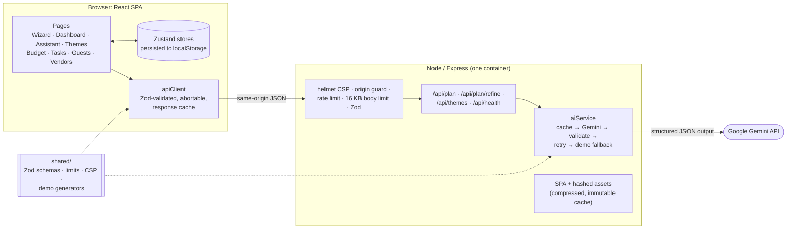

# Utsav: GenAI celebration planner

> Plan weddings, birthdays and community events with a budget, a timeline, a vendor checklist and ideas generated by Google Gemini for _your_ event.

**Live demo:** https://virtualpromptwars5-eventplanner.onrender.com
(Render free tier; the first request after idle can take ~30 s to wake.)

## The problem, and how Utsav solves it

**Challenge:** _"Create a GenAI-powered planning assistant that helps users organize weddings, birthdays, and community events with budgets, timelines, vendor checklists, and personalized ideas."_

| Challenge keyword                         | What delivers it                                                                                                                                                                                                                                                           |
| ----------------------------------------- | -------------------------------------------------------------------------------------------------------------------------------------------------------------------------------------------------------------------------------------------------------------------------- |
| **GenAI-powered assistant**               | **AI Assistant** (`/events/:id/assistant`): Gemini writes a full plan (concept, décor, menu, activities, day-of schedule, suggested tasks, budget split). Refine it in plain language ("make it eco-friendly", "add a sangeet night"), restore any of the last 3 versions. |
| **Weddings, birthdays, community events** | A 6-step **Plan wizard** captures event type, date, city, guests, budget, style and dietary/cultural/accessibility needs. Every AI prompt, starter checklist and budget split is shaped by them.                                                                           |
| **Budgets**                               | **Budget page**: total limit, estimated vs actual per category, over-budget alert, forecast donut and comparison bar chart (each with a data table), inline editing. AI allocations and vendor quotes drop straight in.                                                    |
| **Timelines**                             | **Tasks page**: checklist plus a vertical timeline grouped from "12+ months before" to "Event week", with overdue/due-soon flags and progress. The AI plan adds a minute-by-minute day-of schedule.                                                                        |
| **Vendor checklists**                     | **Vendors page**: filter by category, city, price and rating, shortlist, request a quote, add a vendor's price to the budget. AI-suggested vendor tasks land on the checklist.                                                                                             |
| **Personalized ideas**                    | **Themes page**: 3 Gemini-generated themes (story, 5-colour palette with contrast-safe swatches, décor, matched photo gallery); one click applies a theme to the dashboard. **Guests page** turns RSVPs into dietary headcounts for the caterer.                           |

Every AI action ("Add to checklist", "Add to budget", "Save plan", "Use this theme") and every delete confirms with an **Undo** toast.

## Google Gemini usage

All Gemini calls happen **on the server** (`server/services/`); the API key never reaches the browser.

| Endpoint                | Gemini task                                                    |
| ----------------------- | -------------------------------------------------------------- |
| `POST /api/plan`        | Full event plan from the event brief                           |
| `POST /api/plan/refine` | Revise the current plan from a user instruction                |
| `POST /api/themes`      | Three themes, each with a palette, décor and image keywords    |
| `GET /api/health`       | `{ status, aiMode: "live" \| "demo" }`, never the key or model |

How each request works:

1. **Structured output.** The official `@google/genai` SDK is called with `responseMimeType: "application/json"` and a `responseJsonSchema` derived from the shared Zod schema (`shared/ai.ts` → `server/services/modelSchemas.ts`).
2. **Validation.** The response is parsed and validated with the **same Zod schemas** the browser uses. Malformed output, or a transient 429/500/503, gets **one retry**.
3. **Demo fallback.** If there is no key, a timeout (20 s), or a second failure, the server returns deterministic **demo content** built from the same brief (`shared/demo/`): vegetarian-only menus, Jain/halal notes, budget tiers, traditions. The UI labels it "Demo mode", so the app is always usable.
4. **Prompt-injection guard.** User text is wrapped in `<user_data>` / `<user_request>` blocks, `<` and `>` are neutralised, and the system instruction treats those blocks as data only. Trusted facts (enums, numbers) sit outside them.
5. **Efficiency.** Thinking is kept light for latency (`thinkingBudget: 0` on 2.5 Flash, `LOW` on Gemini 3). Live responses are cached server-side (LRU, 1 h) and client-side (localStorage LRU), keyed by a stable hash of the brief.

Model: `GEMINI_MODEL` (default `gemini-3.8-flash`; `gemini-2.5-flash` also tested).

## Architecture



```text
src/
  app/          router (every page lazy-loaded), layout, navigation
  components/   design-system primitives (Field, FormDialog, FilterSelect, Pagination, …)
  features/     one folder per domain: components/ hooks/ lib/ (pure, tested) store/
  lib/          shared helpers and hooks (useListFilters, usePagination, useDialogForm, undo toast, …)
  routes/       page components and their integration + axe tests
server/         Express app, middleware, Gemini + demo services
shared/         code used by both sides: Zod contracts, limits, CSP, demo generators
```

## Tech stack

React 18 · TypeScript (strict, `noUncheckedIndexedAccess`, no `any`) · Vite 6 · Tailwind CSS 4 · Radix UI · React Router 7 · Zustand · React Hook Form + Zod · Recharts · Framer Motion · Express 5 · `@google/genai` · Vitest + Testing Library + axe · ESLint (strict type-checked, jsx-a11y) · Prettier · Docker.

## Security

- **Secrets:** the Gemini key lives only in server env vars. It is never logged, never in the bundle, never in git (scanned history; `.env` ignored, `.env.example` provided).
- **Headers:** helmet with a strict CSP (`script-src 'self'`, no inline scripts), HSTS, `nosniff`, frame and referrer policies; `x-powered-by` off. The same CSP ships as a `<meta>` tag for static hosting.
- **API hardening:** same-origin only (others get 403), 20 requests/min/IP (429 with `RateLimit` headers), 16 KB body limit (413), strict Zod request schemas that reject unknown fields (400), one JSON error shape with no stack traces, 20 s upstream deadline.
- **Output safety:** AI text is rendered as plain React text, never `dangerouslySetInnerHTML`, and validated against schemas before use.
- **CSV export** neutralises spreadsheet formula injection (`=`, `+`, `-`, `@`).
- **Dependencies:** `npm audit` production findings fixed by upgrading React Router to v7. Remaining: zod 3 (fix requires the breaking v4; mitigated because bodies are capped before Zod runs) and dev-only Vitest tooling (never shipped; Docker installs with `--omit=dev`).

## Accessibility

- Semantic landmarks, skip link, focus moved to each new page/step heading, `aria-live` status for AI loading and results.
- Every control has a label. Form errors are linked with `aria-describedby` and announced. Colour is never the only signal (priority and due badges carry icons and text).
- Charts are labelled images with a "View as table" alternative; reduced motion respected; palette swatches pick contrast-safe text automatically.
- **Verified:** axe checks in the test suite on every page, plus a real-Chrome audit (axe incl. colour contrast and a full keyboard walk) of Budget, Tasks, Guests and Vendors: **0 violations, 365 focus stops all named with a visible focus ring**. Landing, Wizard, Dashboard and Assistant checked at 375 px for overflow.

## Performance

- Every route is its own lazy chunk; only the shell and the React core load up front: **≈121 KB gzipped JS + 11 KB CSS**.
- Heavy libraries load only where used: Recharts (116 KB gz) with the Budget charts, Framer Motion with the wizard.
- Hashed assets are served with `Cache-Control: immutable, max-age=1y`; `index.html` with `no-cache`; Brotli/gzip compression for assets and API JSON.
- Responsive Unsplash images with `srcset`, explicit dimensions (no layout shift) and lazy loading.
- Memoised derived data (filters, summaries, chart rows), memoised list rows, debounced search, paginated lists, and AI response caching on both tiers.

## Testing

**257 tests in 36 files**, run with `npm test` (stable across repeated runs, no warnings):

- **Server (34):** endpoints, validation (400), body limit (413), rate limit (429), origin policy (403), CSP headers, retry and demo fallback, timeout, cache, prompt delimiting, SPA serving.
- **Shared and domain logic:** demo generators, budget maths, timeline grouping, filters, CSV escaping, store migrations, undo restore.
- **Pages (integration):** real route table in a memory router with user-event: wizard, dashboard, assistant, themes, budget, tasks, guests, vendors, including **axe checks on every page**.

CI (`.github/workflows/ci.yml`) runs format check, lint, typecheck, tests and build on every push.

## Run locally

Requires Node 22 (`.nvmrc`).

```sh
npm install
cp .env.example .env      # add GEMINI_API_KEY, or leave it blank for demo mode
npm run dev               # web on http://localhost:5173, API on :8787 (proxied)
```

| Variable         | Purpose                                                           |
| ---------------- | ----------------------------------------------------------------- |
| `GEMINI_API_KEY` | Gemini key. Blank means demo mode (fully functional, labelled).   |
| `GEMINI_MODEL`   | Model id, default `gemini-3.8-flash`.                             |
| `PORT`           | Server port, default `8787` (Render and Cloud Run inject it).     |
| `ALLOWED_ORIGIN` | Optional comma-separated extra origins; same-origin always works. |

| Script                                        | What it does                                      |
| --------------------------------------------- | ------------------------------------------------- |
| `npm run dev`                                 | Vite + API server with reload                     |
| `npm run build`                               | Client bundle (`dist/`) + server (`dist-server/`) |
| `npm start`                                   | Production server: API + SPA on one port          |
| `npm test`                                    | Full test suite                                   |
| `npm run lint` / `typecheck` / `format:check` | Quality gates (all run in CI)                     |

## Deployment

One container serves the SPA and the API from the same origin (`Dockerfile`, multi-stage, non-root, health check on `/api/health`).

- **Render (live demo):** a Docker web service from this repo; set `GEMINI_API_KEY` (and optionally `GEMINI_MODEL`) as environment variables. Render provides `PORT`.
- **Google Cloud Run:** `gcloud run deploy --source .`, with the key held in Secret Manager. See [DEPLOY.md](DEPLOY.md).
