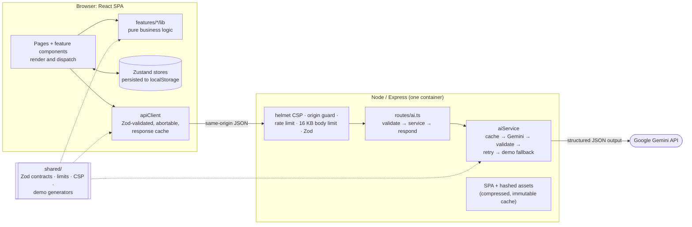

# Utsav: GenAI celebration planner

[](https://github.com/shaikasadahmed2k23/VirtualPromptWars5_EventPlanner/actions/workflows/ci.yml)
[](docs/TESTING.md)
[](docs/TESTING.md#coverage)
[](docs/ACCESSIBILITY.md)
[](LICENSE)

> Plan weddings, birthdays and community events with a budget, a timeline, a vendor checklist and ideas generated by Google Gemini for _your_ event.

**Live demo:** https://virtualpromptwars5-eventplanner.onrender.com
(Render free tier; the first request after idle can take about 30 s to wake.)

## Challenge requirement → feature

**Challenge:** _"Create a GenAI-powered planning assistant that helps users organize weddings, birthdays, and community events with budgets, timelines, vendor checklists, and personalized ideas."_

| Requirement                               | Feature                                                                                                                                                                                                                                              | Where to look                                                                                    |
| ----------------------------------------- | ---------------------------------------------------------------------------------------------------------------------------------------------------------------------------------------------------------------------------------------------------- | ------------------------------------------------------------------------------------------------ |
| **Weddings, birthdays, community events** | A 6-step **plan wizard** captures the event type (wedding, birthday, anniversary, community), date, city, guests, budget, style and dietary, cultural and accessibility needs. Each type gets its own starter checklist, budget split and AI prompt. | `src/features/wizard/`, `src/features/events/lib/starterTemplates.ts`, `shared/budgetWeights.ts` |
| **Budgets**                               | **Budget page:** a total limit, estimated vs actual spend per category, an over-budget alert and inline editing. A forecast donut and a comparison bar chart each come with a data table. AI allocations and vendor prices drop straight in.         | `src/routes/BudgetPage.tsx`, `src/features/budget/lib/`                                          |
| **Timelines**                             | **Tasks page:** a checklist plus a timeline grouped from "12+ months before" to "Event week", with overdue and due-soon flags and progress. The AI plan adds a minute-by-minute day-of schedule.                                                     | `src/features/tasks/lib/taskTimeline.ts`, `src/routes/TasksPage.tsx`                             |
| **Vendor checklists**                     | **Vendors page:** filter by category, city, price and rating; shortlist; request a quote pre-filled from the event; add a vendor's price to the budget. AI-suggested vendor tasks land on the checklist.                                             | `src/routes/VendorsPage.tsx`, `src/features/vendors/`                                            |
| **Personalised ideas**                    | **Themes:** 3 Gemini themes, each with a story, a 5-colour palette with contrast-safe swatches, décor and a matched photo gallery; one click applies a theme. **Guests** turns RSVPs into dietary headcounts for the caterer.                        | `src/routes/ThemesPage.tsx`, `src/features/guests/lib/guestStats.ts`                             |
| **GenAI-powered assistant**               | **AI Assistant:** Gemini writes a full plan (concept, décor, menu, activities, day-of schedule, suggested tasks, budget split). Refine it in plain language ("make it eco-friendly", "add a sangeet night") and restore any of the last 3 versions.  | `src/routes/AssistantPage.tsx`, `server/services/aiService.ts`                                   |

Every AI action ("Add to checklist", "Add to budget", "Save plan", "Use this theme") and every delete confirms with an **Undo** toast.

## Evaluation criteria

| Criterion             | How Utsav addresses it                                                                                                                                                                                                                                                                                                                                                   | Where to look                                                                                                                 |
| --------------------- | ------------------------------------------------------------------------------------------------------------------------------------------------------------------------------------------------------------------------------------------------------------------------------------------------------------------------------------------------------------------------ | ----------------------------------------------------------------------------------------------------------------------------- |
| **Code quality**      | TypeScript strict (`noUncheckedIndexedAccess`, no `any`), ESLint `strictTypeChecked` + `stylisticTypeChecked`. Enforced budgets: files ≤ 300 lines, functions ≤ 60, complexity ≤ 10, nesting ≤ 3, ≤ 4 parameters. Layering enforced: pure logic in `features/*/lib` and `shared/` cannot import React or stores. One typed error path on each side. No dead code (knip). | `eslint.config.js`, [docs/ARCHITECTURE.md](docs/ARCHITECTURE.md), `tests/hygiene.test.ts`, [CONTRIBUTING.md](CONTRIBUTING.md) |
| **Security**          | Key held in server env only. helmet CSP (`script-src 'self'`) plus HSTS and frame, sniff and referrer headers. Same-origin guard, 20 requests/min rate limit, 16 KB body cap, strict Zod schemas, prompt-injection delimiting, CSV formula escaping, no raw HTML. Production audit in CI.                                                                                | [SECURITY.md](SECURITY.md), `server/middleware/`, `server/services/prompts.ts`, `server/security.test.ts`                     |
| **Efficiency**        | Every route lazy-loaded: **≈121 KB gzipped JS + 11 KB CSS** up front, with Recharts (116 KB) loaded only on Budget. Brotli and gzip, immutable caching of hashed assets. AI responses cached on server and client. Memoised derived data and rows, debounced search, paginated lists.                                                                                    | `vite.config.ts`, `src/app/router.tsx`, `server/app.ts`, `server/lib/cache.ts`                                                |
| **Testing**           | **283 tests**: server, shared, pure logic, hooks and every page through the real router, with axe on every page. **97.6% statements / 89.9% branches**, thresholds enforced in CI. Zero stderr.                                                                                                                                                                          | [docs/TESTING.md](docs/TESTING.md), `vite.config.ts` (thresholds), `src/routes/*.test.tsx`                                    |
| **Accessibility**     | Landmarks and a skip link; focus moves to new headings; every control labelled; errors linked with `aria-describedby`; live regions for AI progress; charts have data tables; reduced motion respected. axe: 0 violations; real-browser keyboard walk: 365 focus stops, all named and visibly focused.                                                                   | [docs/ACCESSIBILITY.md](docs/ACCESSIBILITY.md), `src/test/a11y.ts`, `src/styles/contrast.test.ts`                             |
| **Problem alignment** | Each part of the challenge maps to a working feature (table above), with Gemini behind every "personalised" part and deterministic demo content when no key is set.                                                                                                                                                                                                      | [Challenge requirement → feature](#challenge-requirement--feature), `shared/ai.ts`, `shared/demo/`                            |

## Google Gemini usage

All Gemini calls happen **on the server** (`server/services/`); the API key never reaches the browser.

| Endpoint                | Gemini task                                                    |
| ----------------------- | -------------------------------------------------------------- |
| `POST /api/plan`        | Full event plan from the event brief                           |
| `POST /api/plan/refine` | Revise the current plan from a user instruction                |
| `POST /api/themes`      | Three themes, each with a palette, décor and image keywords    |
| `GET /api/health`       | `{ status, aiMode: "live" \| "demo" }`, never the key or model |

How each request works:

1. **Structured output.** The official `@google/genai` SDK is called with
   `responseMimeType: "application/json"` and a `responseJsonSchema`. That
   schema is derived from the shared Zod schema (`shared/ai.ts` →
   `server/services/modelSchemas.ts`).
2. **Validation.** The response is parsed and validated with the **same Zod
   schemas** the browser uses. Malformed output or a transient 429/500/503 gets
   **one retry**.
3. **Demo fallback.** If there is no key, a timeout (20 s) or a second failure,
   the server returns deterministic **demo content** built from the same brief
   (`shared/demo/`). It respects vegetarian-only menus, Jain and halal notes,
   budget tiers and traditions. The UI labels it "Demo mode", so the app is
   always usable.
4. **Prompt-injection guard.** User text is wrapped in `<user_data>` /
   `<user_request>` blocks with `<` and `>` neutralised, and the system
   instruction treats those blocks as data only. Trusted facts (enums,
   numbers) sit outside them.
5. **Efficiency.** Thinking is kept light for latency (`thinkingBudget: 0` on
   2.5 Flash, `LOW` on Gemini 3). Live responses are cached on the server
   (LRU, 1 h) and the client (localStorage LRU), keyed by a stable hash of the
   brief.

Model: `GEMINI_MODEL` (default `gemini-3.8-flash`; `gemini-2.5-flash` also tested).

## Architecture



Layers, their rules and the request data flow: [docs/ARCHITECTURE.md](docs/ARCHITECTURE.md).

## Project layout

```text
src/
  app/            router (every page lazy-loaded), root layout, navigation
  components/ui/  design-system primitives (Field, FormDialog, FilterSelect, Pagination, ConfirmDeleteButton…)
  features/<x>/   one folder per domain (assistant, budget, dashboard, events, guests, landing, tasks, themes, vendors, wizard)
    components/   render + dispatch only
    hooks/        connect stores, logic and requests to components
    lib/          pure business logic, unit-tested in Node (no React; lint-enforced)
    store/        Zustand state, persistence, migrations
  lib/            shared helpers and hooks (apiClient, dates, format, useListFilters, usePagination…)
  routes/         one page per route, with integration + axe tests
  data/           seed data and curated photos
server/
  routes/         thin handlers: validate → call service → respond
  services/       Gemini client, prompts, model schemas, AI orchestration
  middleware/     security headers, origin guard, rate limit, validation, errors
shared/           code used by both sides: Zod contracts, limits, CSP, demo generators
tests/            repository hygiene checks
docs/             architecture, testing, accessibility, deployment
```

## Tech stack

React 18 · TypeScript (strict) · Vite 6 · Tailwind CSS 4 · Radix UI · React Router 7 · Zustand · React Hook Form + Zod · Recharts · Framer Motion · Express 5 · `@google/genai` · Vitest + Testing Library + axe · ESLint · Prettier · Docker.

## Security, accessibility, performance, testing

- **Security:** threat model and controls in [SECURITY.md](SECURITY.md).
- **Accessibility:** what we build in and how we test it in [docs/ACCESSIBILITY.md](docs/ACCESSIBILITY.md).
- **Performance:** **≈121 KB gzipped JS + 11 KB CSS** on first load. Heavy
  libraries load only where used: Recharts (116 KB gzipped) with the budget
  charts, Framer Motion with the wizard. Responsive Unsplash images with
  `srcset`, explicit dimensions and lazy loading. `index.html` is served
  `no-cache`; hashed assets are cached for a year as immutable.
- **Testing:** suites, counts and coverage in [docs/TESTING.md](docs/TESTING.md).

CI (`.github/workflows/ci.yml`) runs on every push: format check, lint,
typecheck, tests with coverage thresholds, build, then
`npm audit --omit=dev --audit-level=high`.

## Run locally

Requires Node 22 (`.nvmrc`).

```sh
npm install
cp .env.example .env      # add GEMINI_API_KEY, or leave it blank for demo mode
npm run dev               # web on http://localhost:5173, API on :8787 (proxied)
```

| Variable         | Purpose                                                           |
| ---------------- | ----------------------------------------------------------------- |
| `GEMINI_API_KEY` | Gemini key. Blank means demo mode (fully functional, labelled).   |
| `GEMINI_MODEL`   | Model id, default `gemini-3.8-flash`.                             |
| `PORT`           | Server port, default `8787` (Render injects it).                  |
| `ALLOWED_ORIGIN` | Optional comma-separated extra origins; same-origin always works. |

| Script                                        | What it does                                      |
| --------------------------------------------- | ------------------------------------------------- |
| `npm run dev`                                 | Vite + API server with reload                     |
| `npm run build`                               | Client bundle (`dist/`) + server (`dist-server/`) |
| `npm start`                                   | Production server: API + SPA on one port          |
| `npm test` / `npm run test:coverage`          | Full test suite / with coverage thresholds        |
| `npm run lint` / `typecheck` / `format:check` | Quality gates (all run in CI)                     |

Conventions and commit style: [CONTRIBUTING.md](CONTRIBUTING.md).

## Deployment

One container serves the SPA and the API from the same origin. The
`Dockerfile` is multi-stage, runs as a non-root user and health-checks
`/api/health`. The live demo is a Render Docker web service with
`GEMINI_API_KEY` set in its environment. Step by step:
[docs/DEPLOYMENT.md](docs/DEPLOYMENT.md).

## Limits, honestly

- **No accounts or sync.** Plans live in one browser's `localStorage`; clearing site data or switching devices loses them. There is no sharing with a partner or planner yet.
- **Sample vendors.** The directory is curated sample data with placeholder contacts; "Request quote" records the request locally and contacts no one.
- **AI quality varies.** Gemini output is schema-validated, so it is always well-formed, but taste and accuracy (prices, local customs) still need a human eye. Demo mode is deterministic and less personal.
- **Known advisory.** `npm audit` reports a high-severity advisory in zod 3 (GHSA-mrhx-c7xc-m3w5, memory use when validating oversized collections). The fix is zod 4, a breaking migration planned as the next step. Exposure is low because request bodies are capped at 16 KB before Zod runs; see [SECURITY.md](SECURITY.md#known-advisories--accepted-risk). Until then the CI audit step is informational (`continue-on-error`), so it reports but does not block.
- **Cold starts.** The free Render instance sleeps when idle, so the first request after a while is slow.
- **Testing gaps.** Phone-width (375 px) layout is checked manually and only on the Landing, Wizard, Dashboard and Assistant pages. Colour contrast is verified on design tokens and in a real-browser audit, not in jsdom.

## License

[MIT](LICENSE)
