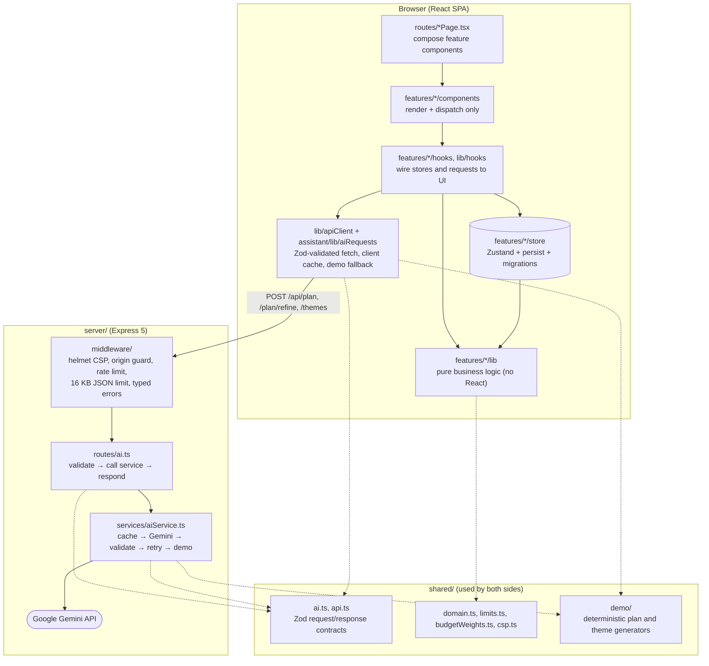

# Architecture

Utsav is a React single-page app and a small Express API in one container.
Planning data lives in the browser (Zustand stores persisted to
`localStorage`). The server exists to hold the Gemini key and to turn an event
brief into validated, structured AI output.

## Layers and their rules

| Layer                                              | Responsibility                                                                                                           | Must not                                                    |
| -------------------------------------------------- | ------------------------------------------------------------------------------------------------------------------------ | ----------------------------------------------------------- |
| `shared/`                                          | Contracts (Zod), domain enums, limits, the CSP and demo generators. Compiled into both the SPA and the server.           | Import from `src/`, React, UI or state libraries.           |
| `src/features/*/lib/`                              | Pure business logic: budget maths, timeline grouping, filters, CSV export, starter plans, plan → task/budget conversion. | Import React, stores, hooks or components.                  |
| `src/features/*/store/`                            | Zustand state, persistence, versioned migrations, cross-store operations (`events/store/eventLifecycle.ts`).             | Render UI.                                                  |
| `src/features/*/hooks/`, `src/lib/hooks/`          | Connect stores, pure logic and requests to components; own async state (abort, retry, loading).                          | Contain business rules better expressed as a pure function. |
| `src/features/*/components/`, `src/components/ui/` | Render and dispatch user intent to hooks and stores.                                                                     | Compute business results inline.                            |
| `src/routes/`                                      | One lazy-loaded page per route; compose feature components.                                                              | Hold feature logic.                                         |
| `server/routes/`                                   | Thin handlers: validate the body (`withValidatedBody`), call the service, respond in the shared envelope.                | Talk to Gemini or shape errors themselves.                  |
| `server/services/`                                 | AI orchestration, prompts, model schemas, output parsing.                                                                | Know about Express.                                         |

**Enforced by ESLint** (`eslint.config.js`): `features/*/lib` and `shared/`
cannot import React, React Router, Zustand, Sonner, Lucide, or any
`components/`, `store/` or `hooks/` module, and `shared/` cannot import `src/`.
Size and complexity budgets apply everywhere: max-lines 300,
max-lines-per-function 60, complexity 10, max-depth 3, max-params 4.

## Data flow: generating a plan

1. **Page:** `AssistantPage` calls `useAIPlan(event)`. The hook builds an
   `EventBrief` from the stored event (`toEventBrief`).
2. **Client:** `requestPlan` checks the client cache (`responseCache`, a
   localStorage LRU keyed by a stable hash of the brief). On a miss, `postAI`
   POSTs to `/api/plan` with an abort signal and a 25 s deadline.
3. **Middleware:** the server applies the security headers, the origin guard
   (403), the rate limit (429) and the 16 KB body limit (413). Then
   `withValidatedBody` checks the shared Zod schema (400 with field issues).
4. **Service:** `aiService` checks its LRU cache, then calls Gemini with
   structured output (`responseJsonSchema` derived from the same Zod schema)
   under a 20 s deadline. It parses and validates the reply. It retries once
   on malformed output or a 429/500/503, and otherwise returns deterministic
   demo content from `shared/demo`, flagged `aiMode: "demo"`.
5. **Response:** `{ data, meta: { aiMode, cached, generatedAt } }`. The client
   validates the envelope and `data` again before trusting them.
6. **Fallback:** if the server is unreachable (offline, static hosting), the
   client generates the same demo content locally, so the app keeps working.
7. **Store:** the plan is stored per event, with the previous version kept in
   history. Actions such as "Add to checklist" go through `planActions` (pure)
   into the task and budget stores, each with an Undo toast.

## Errors

- **Server:** every client-facing failure is an `ApiError` (status, code,
  message, optional field issues), sent by `sendError` in one JSON shape.
  Anything unexpected is logged by name only and returned as a generic 500.
  Stack traces and model text never reach the client.
- **Client:** transport and HTTP failures become `ApiClientError` with a typed
  code. `describeApiError` maps codes to friendly copy. Storage and clipboard
  failures are caught, logged in development and degrade gracefully.
